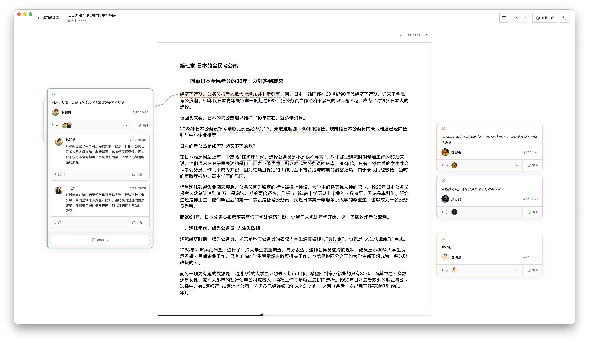

<p align="center">
  
</p>

# Yomitomo

Yomitomo is a local-first AI reading companion desktop app. The Electron desktop app handles web article, EPUB/AZW3/MOBI ebook, and PDF imports, the reading library, highlights, notes, discussion comments, distillations, reader Q&A, WeRead sync, LLM provider management, and reading assistants. The Astro website provides product pages, download entry points, documentation in Chinese, English, and Japanese, and social previews.

You can currently download macOS Apple Silicon and Windows x64 installers from [yomitomo.app](https://yomitomo.app) or [GitHub Releases](https://github.com/xingkaixin/yomitomo/releases). The project is still in early alpha.

## Core capabilities

- Web article import: extract body text, title, author, site metadata, and images from URLs.
- Ebook import and reading: import local EPUB, AZW3, and MOBI files, and persist chapters, covers, and the original book files.
- PDF import and reading: import local PDF files with outline, selection, highlights, and notes.
- Desktop reader: outline, font size, content width, highlights, full-text search, reader Q&A, floating toolbar, dual note sidebars, selection shortcuts, arrow-key paging, and annotation navigation; bilingual translation for web articles and chapter-level bilingual reading for ebooks.
- Text annotations: highlights, annotation types, thought threads, discussion comments, distillation publishing, and `@assistant` triggers; discussion and distillation flows include motion and optional sound feedback (toggle in Settings).
- Reading assistants: mention `@assistant` in a discussion, ask an assistant to add a thought under a highlight, or ask about the article in reader Q&A. Assistants read the surrounding text on demand, and their replies link to the passages they cite.
- WeRead sync: sync book notes, thoughts, and reading statistics after configuring an API key.
- Reading library: manage web articles, ebooks, annotations, comments, and original-source links in one place.
- Distillation library: gather every published distillation into one searchable, read-only list with source context and a jump back to the original annotation.
- Reading memory: a local multilingual embedding model indexes highlights, thoughts, discussions, and published distillations for related reading, questions across the library, and revisiting past judgments. Every AI claim cites a saved record and jumps back to the source text.
- UI and themes: Chinese, English, and Japanese interfaces, and multiple themes including dusk indigo and hand-drawn ink paper.
- App updates and data management: check for updates, view release notes, open the data directory, view logs, and back up or restore the database together with original ebooks, PDFs, and PDF thumbnails; API keys are excluded from complete backups. macOS installers are signed and notarized.
- Reading statistics: generate local reading trends by article, annotation, and discussion.
- Local-first reading privacy: reading content, book titles, annotations, file paths, AI conversations, and provider API keys stay local; anonymous app, version, and system metrics are sent at most once per day by default and can be disabled in Settings.

## Screenshots

### Electron desktop app



## Project structure

```text
apps/desktop       Electron desktop app, including main, preload, and renderer
apps/web           Astro product website, including landing page, download entry point, SEO, and static product images
apps/download      Cloudflare Worker for download.yomitomo.app and auto-update asset proxying
apps/telemetry     Cloudflare Worker that receives anonymous desktop heartbeats into Analytics Engine
packages/ai        LLM provider calls, model input budgeting, and AI generation pipelines
packages/core      Core business logic, including annotations, comments, reading statistics, EPUB/PDF indexing, and pure reader DOM logic
packages/reader-ui Desktop reader React UI, styles, utilities, and hooks
packages/shared    Shared types, provider presets, agent presets, IDs, hashes, text anchoring, PDF, and WeRead protocol types
assets             Project static assets
```

## Tech stack

- Package manager: `pnpm@12.x`
- Build orchestration: Turbo
- Language: TypeScript, ESM
- Desktop: Electron 45, electron-vite, React 19, Vite 8, Tailwind CSS 4
- Website: Astro 7, React 19, Vite 8, Tailwind CSS 4
- Local database: SQLite, better-sqlite3, Drizzle ORM
- Tests: Vitest
- Lint / format: oxlint and oxfmt through Turbo

## Run from source

### Prerequisites

- Node.js
- pnpm 12
- macOS desktop development environment
- Xcode Command Line Tools for `better-sqlite3` native rebuilds

Install dependencies:

```bash
pnpm install
```

Verify the desktop native dependency boundary:

```bash
pnpm --filter @yomitomo/desktop native:verify
```

Run this command after upgrading Electron or `better-sqlite3` to confirm that plain Node/Vitest and the Electron app use their own `better-sqlite3` native roots.

### Run the desktop app

```bash
pnpm --filter @yomitomo/desktop dev
```

After startup, the desktop app will:

- Store `yomitomo.sqlite` under Electron's `userData` directory.
- Provide user, provider, assistant, reading library, statistics, and log views.
- Support importing web URLs, local EPUB/AZW3/MOBI files, or local PDF files from the reading library.

### Run the website

```bash
pnpm --filter @yomitomo/web dev
```

Use the website dev server to preview the landing page, download links, SEO metadata, and static product images.

### Package release artifacts

Build the default release artifact from the repository root:

```bash
pnpm make
```

`pnpm make` generates the macOS arm64 desktop installer under `dist/app/mac-arm64`, including the `dmg` and `zip` produced by electron-builder.

You can also package individual targets:

```bash
pnpm make:app:mac-arm
pnpm make:app:win-x64
```

`pnpm make:app:win-x64` generates the Windows x64 NSIS installer under `dist/app/win-x64`. Configure macOS signing, notarization, and Windows signing policies for your release channel before public distribution.

Pushing a `vX.Y.Z` tag triggers the GitHub Release workflow, which builds and uploads macOS `.dmg` / `.zip`, Windows `.exe`, blockmap files, and `latest*.yml` update metadata.

### Local reading and AI configuration

1. Start the desktop app.
2. Create an LLM provider on the Providers page, then enter the base URL, API key, and model name.
3. Create annotation assistants or review assistants on the Assistants page, and connect them to a provider.
4. Import a web URL, local EPUB/AZW3/MOBI file, or local PDF file from the Reading Library.
5. Open an article, ebook, or PDF, and select text to highlight it and write a thought. Mention `@assistant` in a discussion to bring in an assistant.
6. To sync WeRead, configure a WeRead API key in Settings and then sync notes and reading statistics.

### Run workspace dev tasks together

```bash
pnpm dev
```

`pnpm dev` starts each workspace development task through Turbo.

## Common commands

```bash
pnpm dev:app
pnpm dev:web
pnpm lint
pnpm lint:fix
pnpm format
pnpm format:check
pnpm ui:check-primitives
pnpm typecheck
pnpm test
pnpm build
```

## Data

- The desktop app stores users, providers, assistants, articles, PDF metadata, WeRead sync data, annotations, comments, and reading progress in SQLite.
- Provider API keys are stored in the system keyring. The database only stores key references and provider configuration.
- When importing an article from a web URL, the desktop app reads the target page and creates a local article record.
- When importing an EPUB, AZW3, or MOBI ebook, the desktop app stores the original ebook file, chapter index, and local article record.
- When importing a PDF, the desktop app stores the original PDF file, page information, and local article record.

## Layering conventions

- `packages/shared` contains shared types, provider presets, agent presets, IDs/hashes, text anchoring, PDF, and WeRead protocol types.
- `packages/core` contains pure logic for annotations, comments, reading statistics, EPUB/PDF indexing, and reader DOM behavior.
- `packages/ai` contains pi-ai provider calls, the single-shot generation runtime, model input budgeting, assistant and distillation review prompts, translation, and reading memory judgment.
- `packages/reader-ui` contains the desktop reader React UI, styles, utilities, and hooks.
- `apps/desktop/src/main` contains the Electron main process, SQLite store, LLM calls, article/ebook/PDF import, WeRead sync, and logging.
- `apps/desktop/src/renderer/src/reading-library`, `apps/desktop/src/renderer/src/reading-stats`, `apps/desktop/src/renderer/src/settings`, `apps/desktop/src/renderer/src/shell`, and `apps/desktop/src/renderer/src/source` contain the desktop library, statistics, settings, application shell/log UI, and Web/EPUB/PDF reader surfaces.
- `apps/web/src` contains Astro website pages, product carousel, and global styles. Download links are generated from the version in `apps/desktop/package.json`.
- `apps/download/src` contains the Cloudflare Worker that proxies GitHub Release installers, update manifests, and blockmap files for `download.yomitomo.app`.
- `apps/telemetry/src` contains the Cloudflare Worker that receives anonymous desktop heartbeats and writes them to Analytics Engine.

## Pre-commit checks

`mise run check` mirrors the GitHub Actions check order:

```bash
mise run check
```

For a faster local loop before the full gate, use:

```bash
mise run check:fast
```

The full gate expands to:

<!-- gate:check -->
```bash
pnpm lint
pnpm gate:check
pnpm effect:check
pnpm docs:check-paths
pnpm ui:check-primitives
pnpm format:check
pnpm typecheck
pnpm test
pnpm build
pnpm test:app:e2e:from-dist
```

On headless Linux, run the full gate through Xvfb:

```bash
xvfb-run -a mise run check
```

## License

Yomitomo is released under the [MIT](LICENSE) license.

Copyright 2026 Yomitomo contributors.

Third-party production dependency and vendored component licenses are listed in [THIRD_PARTY_NOTICES.md](THIRD_PARTY_NOTICES.md). Regenerate the list with:

```bash
pnpm licenses:generate
```
